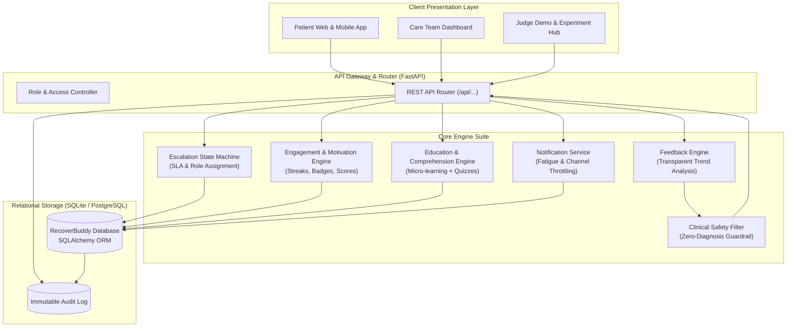
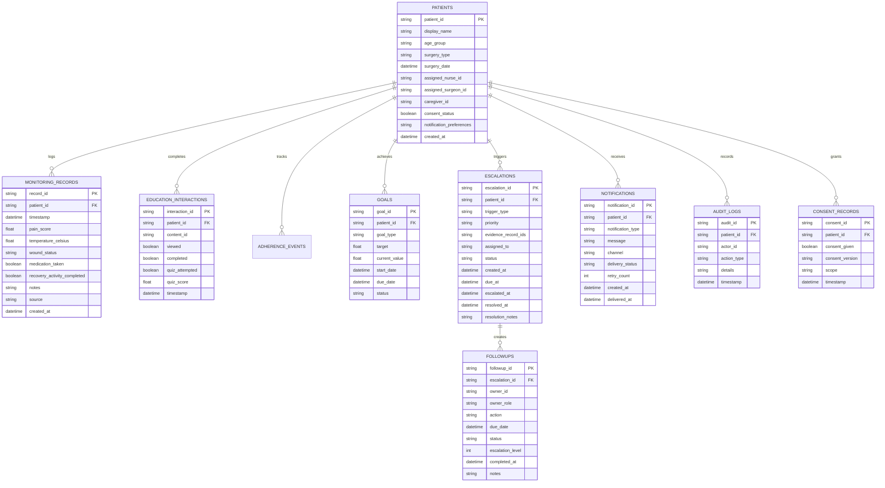
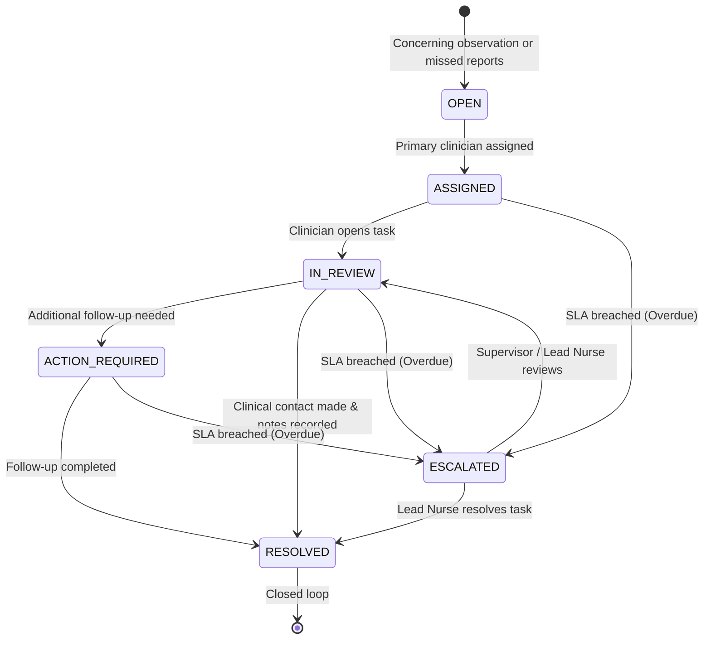
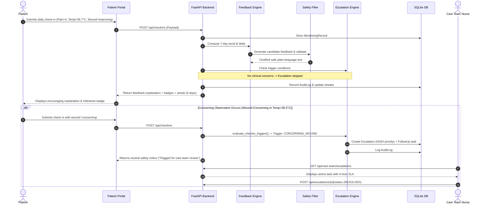

# System Architecture: RecoverBuddy

## 1. High-Level System Architecture

---

## 2. Relational Entity-Relationship (ER) Model

---

## 3. Escalation State Machine

---

## 4. End-to-End Data Flow Pipeline

